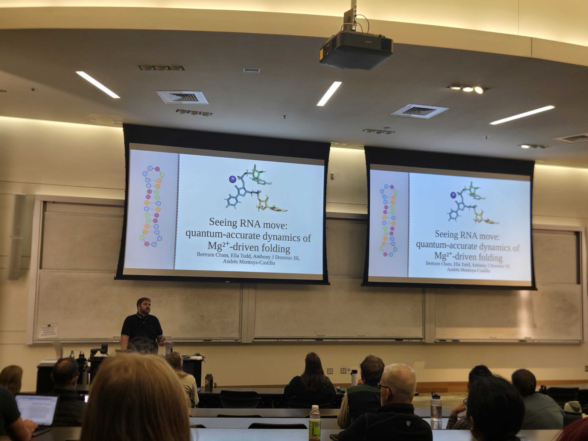

Bert presented his project with Ella Todd and Anthony Dominic, "Seeing RNA
move: quantum-accurate dynamics of Mg²⁺-driven folding," to the Biophysics
group on Friday, November 13. Congratulations, Bert, on a job well done!

  

