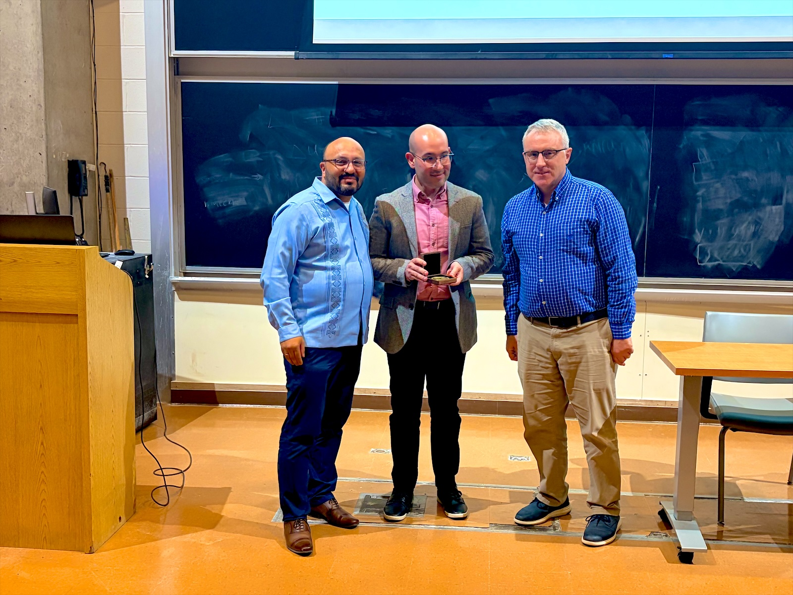
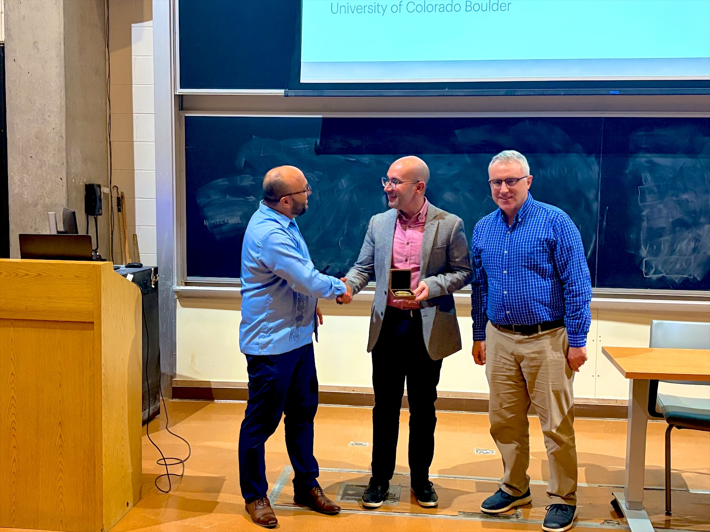
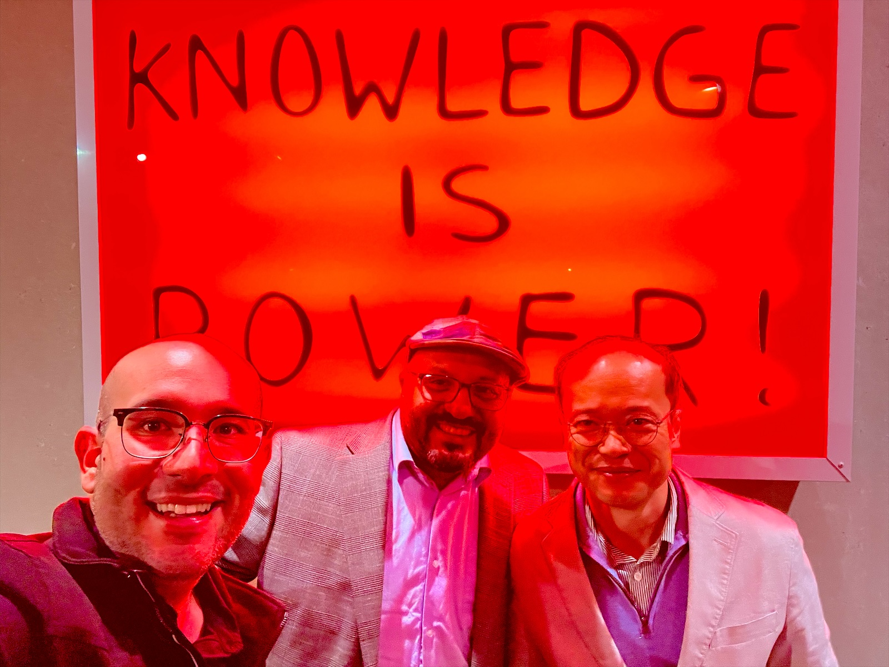

Andrés gave the Magomedov-Shcherbinina Lecture at the University of
Rochester, the first theorist to do so in the lecture's history! He had a
wonderful visit and is very grateful for the honor and for the kindness of
his colleagues at Rochester.

  
  
  

Above: receiving the medal with Ignacio Franco and Todd Krauss, and with
Ignacio Franco and Young Min Rhee.
